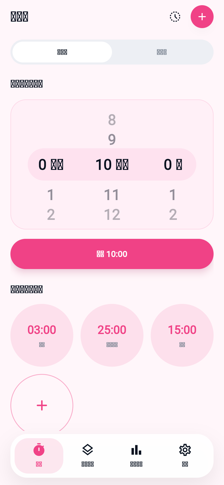
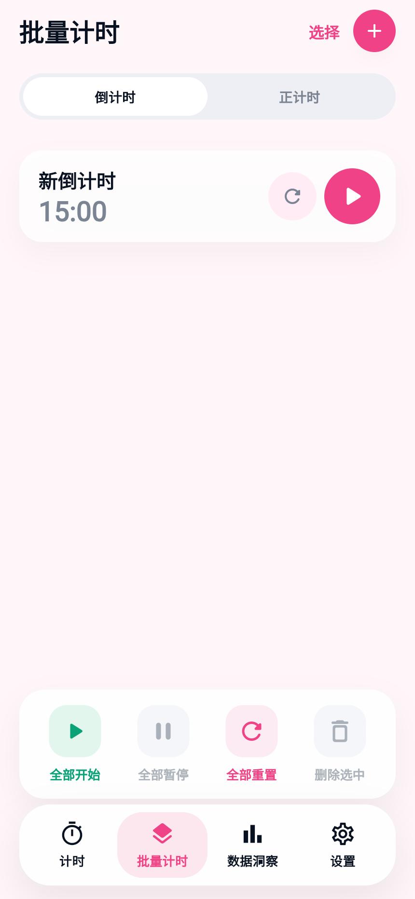
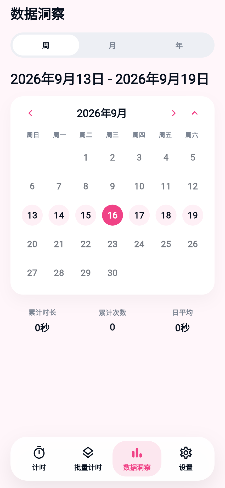
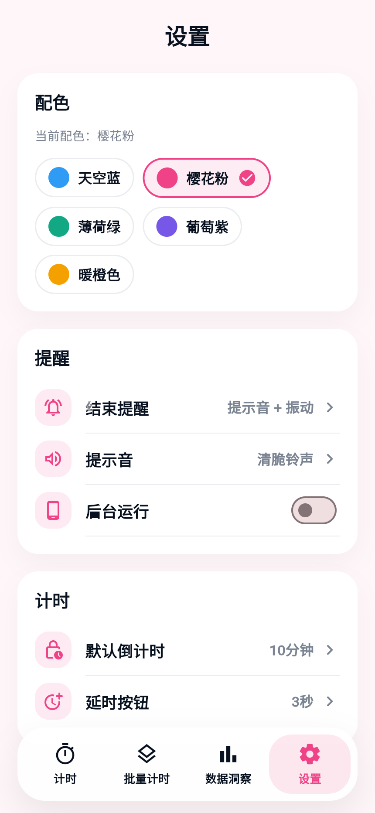

# Timer App 计时器

一款简洁的计时工具，适合学习、阅读、练字、运动等日常场景。支持倒计时、正计时和多个计时同时运行，计时记录保存在手机本地，无需注册账号，日常使用无需联网。

[下载 Android 安装包](https://github.com/mytechdream/timer-app/releases/download/latest/timer-app-latest.apk) · [查看最新版本](https://github.com/mytechdream/timer-app/releases/tag/latest)

## 安装与更新

1. 下载上方的 Android 安装包，或在发布页面找到 timer-app-latest.apk。
2. 在手机上打开安装包，按照系统提示完成安装。建议只从本仓库的发布页面下载安装包。
3. 打开应用即可计时；需要结束提醒时，请按提示允许通知权限。

更新时优先直接覆盖安装，不要先卸载。卸载应用或清除应用数据可能导致本地记录丢失。

## 可以做什么

- **倒计时**：用滚轮选择时长，或直接使用「刷牙」「番茄时钟」「练字」等预设；支持暂停、延时和全屏显示。
- **正计时**：为阅读、口算、运动等活动计时，可添加自己的标签。
- **批量计时**：同时运行多个倒计时或正计时，支持多选和批量启停；计时项与首页分开保存。
- **数据回顾**：查看已保存的历史记录，通过日历和汇总数据回顾计时时长与次数。
- **结束提醒**：选择仅提示音、提示音加振动，或关闭提醒；也可开启后台运行。
- **个性化**：选择天空蓝、樱花粉、薄荷绿、葡萄紫、暖橙色或番茄红配色，调整提示音、默认时长和延时秒数。

## 界面预览

| 计时首页 | 批量计时 |
| --- | --- |
|  |  |

| 数据洞察 | 设置 |
| --- | --- |
|  |  |

## 开始使用

### 单个计时

在「计时」页面选择「倒计时」或「正计时」，设置时长或选择标签，然后点击开始。倒计时也可以直接点击预设卡片启动。

全屏计时会显示当前年月日并保持屏幕常亮，暂停时仍然常亮；倒计时结束或退出全屏后恢复系统息屏设置。

通过页面右上角的添加按钮，可以创建自己的倒计时预设或正计时标签。长按已有卡片或标签，可以进入编辑或删除操作。

### 同时运行多个计时

进入「批量计时」，添加需要的计时项，分别启动或使用批量启停操作。不同倒计时各自提醒，暂停或删除其中一项不会取消其他项的提醒。

首页与批量计时的预设和标签各自独立，新增、改名或删除只影响当前页面。升级时，旧版本共用的自定义项目会在两页各保留一份，之后可以分别管理。

### 查看记录与统计

在「计时」页面通过右上角的历史记录按钮查看记录；进入「数据洞察」，按日期回顾计时情况。

目前记录首页完成的倒计时，以及确认退出时保存的正计时；中途取消的倒计时和批量计时暂不写入历史。历史保留最近 100 条，统计以这些已保存的记录为准。

## 提醒设置与常见问题

### 计时结束后没有声音或振动怎么办？

- 在应用「设置 → 结束提醒」中，选择「仅提示音」或「提示音 + 振动」，不要选择「关闭」。
- 在手机的应用通知设置中允许通知，并检查声音、振动和勿扰模式。
- 如果没有出现授权弹窗，可以长按应用图标进入应用信息，手动检查通知权限。
- 如果应用提示提醒可能延迟，请按提示检查精确提醒的授权。

不同手机的设置入口可能不同。调整后，建议用一个几秒钟的倒计时先测试提醒。

### 锁屏或切到其他应用后，还能提醒吗？

应用支持后台结束提醒，也可在「设置」中开启「后台运行」。如果锁屏后提醒不稳定，请检查手机的后台运行、启动管理和电池限制设置。

后台提醒仍受系统权限、省电策略和厂商限制影响，不能保证在所有机型或被强制停止后都准时触发。

### 记录能同步到另一部手机吗？

目前不支持账号登录、云备份或跨设备同步。记录保存在当前手机本地，请勿通过卸载或清除数据来排查问题，以免丢失记录。

### 有 iPhone 安装包吗？

目前发布页面提供 Android 安装包，暂不提供 iPhone 安装包。

## 问题反馈

欢迎反馈使用问题或功能建议：[1838492264@qq.com](mailto:1838492264@qq.com)。

反馈时请附上手机型号、系统版本、应用版本，以及复现步骤或截图；提醒问题请说明发生在前台、后台还是锁屏状态。

开发与构建说明见[开发指南](docs/DEVELOPMENT.md)，提示音素材说明见[音效来源](AUDIO_CREDITS.md)。
